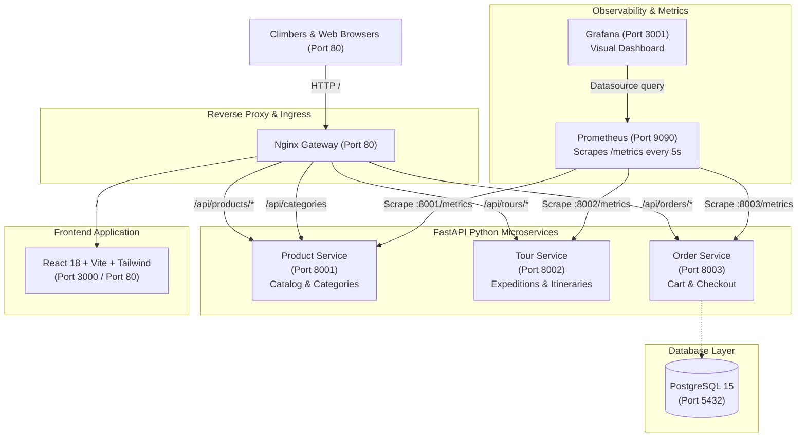

# ZENITH — Beyond the Summit
### Cloud-Native Microservices E-Commerce & Mountain Expedition Platform

[](https://www.docker.com/)
[](https://fastapi.tiangolo.com/)
[](https://react.dev/)
[](https://prometheus.io/)
[](https://grafana.com/)
[](https://www.jenkins.io/)
[](https://www.terraform.io/)

---

## 1. What is ZENITH?

**ZENITH — Beyond the Summit** is a premium outdoor adventure and high-altitude mountaineering brand. The platform is designed as an end-to-end cloud-native microservices portfolio project demonstrating production-oriented software architecture, containerization, CI/CD, and infrastructure observability.

The business encompasses two main categories:
1. **Mountaineering Equipment Store**: Death-Zone double boots, dry climbing ropes, technical ice axes, forged crampons, 4-season geodesic expedition tents, -40°C down sleeping bags, and alpine Gore-Tex hardshells.
2. **Mountain Expeditions & Guided Summits**: World-class expeditions to iconic peaks including Mount Everest Base Camp (Nepal), Mount Kilimanjaro (Tanzania), Mont Blanc (France/Italy), Mount Elbrus (Russia), Mount Toubkal (Morocco), and Mount Sinai (Egypt).

---

## 2. Architecture Overview & Mermaid Diagram

The application uses an API Gateway pattern where all traffic enters through an **Nginx Reverse Proxy**. The frontend never communicates directly with internal microservice ports; requests are cleanly routed based on path prefixes.



---

## 3. The Three Backend Microservices

Each microservice is an independent, lightweight FastAPI application with its own directory, Dockerfile, requirements.txt, healthcheck, and Prometheus instrumentation:

### 1. Product Service (`services/product-service`, Port 8001)
- **Role**: Manages the mountaineering equipment catalog, categories, search, and filtering.
- **Endpoints**:
  - `GET /api/products` (optional `?category=`, `?search=`)
  - `GET /api/products/{id}`
  - `GET /api/categories`
  - `GET /health`
  - `GET /metrics`

### 2. Tour Service (`services/tour-service`, Port 8002)
- **Role**: Manages high-altitude expeditions, mountain elevations, durations, itineraries, and guide credentials.
- **Endpoints**:
  - `GET /api/tours` (optional `?difficulty=`)
  - `GET /api/tours/{id}`
  - `GET /health`
  - `GET /metrics`

### 3. Order Service (`services/order-service`, Port 8003)
- **Role**: Processes gear bag orders, calculates subtotals, taxes, and shipping, and records order history.
- **Endpoints**:
  - `POST /api/orders` (places new order, returns unique order code like `ZEN-ORD-90412`)
  - `GET /api/orders` (lists order history)
  - `GET /health`
  - `GET /metrics`

---

## 4. Port Reference Table

| Service | Internal Port | Host Port | Purpose |
| :--- | :--- | :--- | :--- |
| **Nginx API Gateway** | `8080` | `80` | Single entry point for website & APIs |
| **Frontend UI (Direct)** | `8080` | `3000` | React Vite production container |
| **Product Service** | `8001` | `8001` | Equipment catalog microservice |
| **Tour Service** | `8002` | `8002` | Mountain expeditions microservice |
| **Order Service** | `8003` | `8003` | Cart & checkout orders microservice |
| **PostgreSQL Database** | `5432` | `5432` | Relational persistence |
| **Prometheus** | `9090` | `9090` | Metrics scraper & timeseries DB |
| **Grafana** | `3000` | `3001` | Monitoring dashboards (`admin` / `admin`) |

---

## 5. Quick Start — Running with Docker Compose

Ensure Docker and Docker Compose are installed on your system.

### Step 1: Clone and Enter the Repository
```bash
git clone <your-repo-url>
cd zenith
```

### Step 2: Build and Launch All Containers
```bash
docker compose up --build -d
```

### Step 3: Verify Container Health
```bash
docker compose ps
```

### Step 4: Access the Applications in Your Browser
- **Main Website**: [http://localhost](http://localhost) (or [http://localhost:3000](http://localhost:3000))
- **Equipment Store**: [http://localhost/shop](http://localhost/shop)
- **Expeditions Catalog**: [http://localhost/expeditions](http://localhost/expeditions)
- **Prometheus UI**: [http://localhost:9090](http://localhost:9090)
- **Grafana Dashboard**: [http://localhost:3001](http://localhost:3001) *(Login: `admin` / `admin`)*
- **Gateway Health**: [http://localhost/gateway-health](http://localhost/gateway-health)

### Step 5: Stopping the Environment
```bash
docker compose down
```

---

## 6. How Prometheus & Grafana Monitoring Works

1. **Instrumentation**: Each FastAPI microservice records every HTTP request status and latency in memory.
2. **Scraping**: Prometheus runs on port `9090` and scrapes the `/metrics` endpoint of each service every 5 seconds.
3. **Automated Provisioning**: Grafana automatically loads:
   - Datasource definition (`monitoring/grafana/provisioning/datasources/datasource.yml`)
   - Dashboard provider (`monitoring/grafana/provisioning/dashboards/dashboard.yml`)
   - Pre-configured dashboard (`monitoring/grafana/dashboards/zenith-dashboard.json`)
4. **Metrics Tracked**:
   - `zenith_http_requests_total`: Total requests processed per service & status code
   - `zenith_http_request_duration_seconds`: Average response latency
   - `zenith_orders_created_total`: Real-time counter of orders placed through the website
   - `zenith_service_uptime_seconds`: Running uptime of each service

---

## 7. How Jenkins CI/CD Works

The `jenkins/Jenkinsfile` defines a 6-stage declarative pipeline:
1. **Checkout Code**: Clones the latest branch from GitHub.
2. **Static Checks & Tests**: Verifies Python syntax and FastAPI endpoint contracts.
3. **Build Frontend**: Compiles React TypeScript/JavaScript assets with Vite.
4. **Build Docker Images**: Builds all 4 container images in parallel (`docker compose build`).
5. **Deploy Local Stack**: Launches the container cluster with health-check verification (`docker compose up -d`).
6. **Smoke Tests**: Curls the API Gateway and health endpoints to ensure zero downtime.

---

## 8. Future AWS Deployment via Terraform

A clean roadmap and Terraform HCL blueprints are prepared inside `terraform/README.md`.
The target cloud architecture replaces local Docker Compose components with AWS managed services:
- **Nginx Gateway** $\rightarrow$ **AWS Application Load Balancer (ALB)** with path routing rules
- **Docker Containers** $\rightarrow$ **AWS ECS Fargate** serverless tasks
- **Local PostgreSQL** $\rightarrow$ **Amazon RDS PostgreSQL (Multi-AZ)**
- **Local Docker Engine** $\rightarrow$ **Amazon Elastic Container Registry (ECR)**
- **Prometheus / Grafana** $\rightarrow$ **Amazon CloudWatch** & AWS Managed Grafana

---

## 9. Project Directory Tree

```
zenith/
│
├── frontend/                     # React 18 + Vite + Tailwind CSS
│   ├── src/
│   │   ├── components/           # Navbar, Footer, CartDrawer, Modals
│   │   ├── context/              # Cart state management & localStorage
│   │   ├── data/                 # 15 climbing products & 6 mountain tours
│   │   ├── pages/                # HomePage, ShopPage, ExpeditionsPage
│   │   ├── services/             # API client with fallback data
│   │   ├── App.jsx
│   │   └── main.jsx
│   ├── .dockerignore
│   ├── Dockerfile                # Multi-stage build, non-root Nginx runtime
│   ├── nginx.conf                # Frontend SPA Nginx config
│   ├── package.json
│   └── vite.config.js
│
├── services/                     # 3 Independent FastAPI Microservices
│   ├── product-service/          # Equipment catalog & categories (Port 8001)
│   │   ├── .dockerignore
│   │   ├── Dockerfile
│   │   ├── main.py
│   │   └── requirements.txt
│   │
│   ├── tour-service/             # Expeditions & itineraries (Port 8002)
│   │   ├── .dockerignore
│   │   ├── Dockerfile
│   │   ├── main.py
│   │   └── requirements.txt
│   │
│   └── order-service/            # Cart checkout & order records (Port 8003)
│       ├── .dockerignore
│       ├── Dockerfile
│       ├── main.py
│       └── requirements.txt
│
├── nginx/                        # API Gateway & Reverse Proxy
│   └── nginx.conf
│
├── monitoring/                   # Observability Stack
│   ├── prometheus/
│   │   └── prometheus.yml        # Scrape configs for all 3 microservices
│   └── grafana/
│       ├── dashboards/           # Pre-built monitoring dashboard
│       └── provisioning/         # Automated datasource & dashboard loader
│
├── jenkins/
│   └── Jenkinsfile               # 6-Stage declarative CI/CD pipeline
│
├── terraform/
│   └── README.md                 # Complete AWS production architecture plan
│
├── docker-compose.yml            # Orchestrates all 8 services
├── .env.example
├── .gitignore
└── README.md
```

---

## 10. Interview Talking Points (Cheat Sheet)

When discussing ZENITH during a DevOps or Full-Stack interview:
1. **Why Microservices here?**
   - The equipment store (high browse volume) and tour bookings (low volume, high value) have different scaling profiles. Splitting them into independent services allows scaling `product-service` without scaling `order-service`.
2. **Why Nginx as an API Gateway?**
   - Centralizes CORS handling, hides internal Docker network topology, and mirrors how an AWS Application Load Balancer routes traffic in production.
3. **How does observability work?**
   - Each FastAPI microservice exposes `/metrics` formatted in standard Prometheus exposition format. Prometheus scrapes them every 5 seconds, and Grafana visualizes request throughput, latency, and container uptime.
4. **How is state managed?**
   - Frontend cart items persist in `localStorage` for responsive UX. Orders are dispatched to `order-service` which can persist to PostgreSQL.
