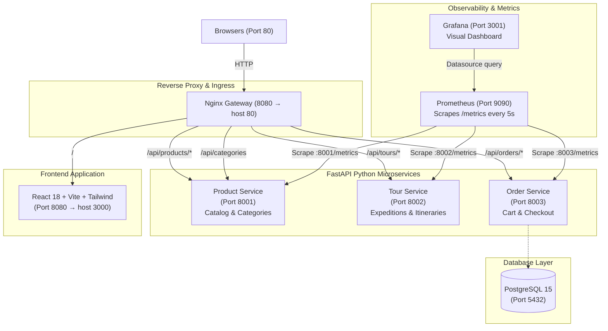

# ZENITH — Beyond the Summit

[](https://www.docker.com/)
[](https://fastapi.tiangolo.com/)
[](https://react.dev/)
[](https://www.postgresql.org/)
[](https://prometheus.io/)
[](https://grafana.com/)
[](https://www.jenkins.io/)
[](https://www.terraform.io/)

A cloud-native microservices e-commerce and mountain expedition platform. **ZENITH** combines a **React 18** storefront with three independent **FastAPI** microservices behind an **Nginx** API gateway, backed by **PostgreSQL**, instrumented with **Prometheus + Grafana**, delivered by a **Jenkins** pipeline, and provisioned on **AWS** with **Terraform** (ECS Fargate · ALB · RDS · CloudWatch).

---

## 🏗️ Architecture



---

## 🧭 Architecture Overview

### 1. 💻 Frontend (React 18 + Vite + Tailwind)

- Single-page storefront with **Shop**, **Expeditions** and **Home** pages
- Cart state held in context and persisted to `localStorage`
- Talks only to the gateway — never to internal service ports
- Falls back to bundled sample data if an API is unreachable

### 2. ⚙️ Three Backend Microservices (FastAPI)

| Service | Port | Role | Key endpoints |
| :--- | :--- | :--- | :--- |
| **product-service** | `8001` | Equipment catalog, categories, search | `GET /api/products` · `GET /api/categories` |
| **tour-service** | `8002` | Expeditions, itineraries, guides | `GET /api/tours` · `GET /api/tours/{id}` |
| **order-service** | `8003` | Checkout, totals, order history | `POST /api/orders` · `GET /api/orders` |

Every service exposes `GET /health` and `GET /metrics` (Prometheus exposition format).

### 3. 🚪 Nginx API Gateway

Single entry point on port `80`. Routes by path prefix and handles CORS centrally:

- `/api/products*`, `/api/categories*` → product-service
- `/api/tours*` → tour-service
- `/api/orders*` → order-service
- `/` → frontend

### 4. 🗄️ PostgreSQL Persistence

`order-service` persists orders to **PostgreSQL 15** through `services/order-service/db.py`:

- Connection pool sized for FastAPI's threadpool, idempotent schema creation, seed-on-empty
- Driven entirely by `DATABASE_URL` — set it and orders are durable; unset and the service runs in memory
- Returns `503` on storage failure rather than silently dropping an order

### 5. 📊 Observability (Prometheus + Grafana)

- Each service records request count, latency, uptime and an orders-created counter
- Prometheus scrapes all three `/metrics` endpoints every **5 seconds**
- Grafana auto-provisions its datasource and a **6-panel dashboard** — no manual setup
- Metrics: `zenith_http_requests_total` · `zenith_http_request_duration_seconds` · `zenith_orders_created_total` · `zenith_service_uptime_seconds`

### 6. 🔁 Jenkins CI/CD Pipeline

Six stages, defined in `jenkins/Jenkinsfile`:

1. **Checkout Code** — clone from GitHub
2. **Static Checks** — Python syntax + `scripts/verify_all.py`
3. **AWS Auth & ECR Login** — credential `aws-credentials`
4. **Build & Push Images** — all 4 images to ECR
5. **Deploy to ECS** — force new deployment, wait for stable
6. **Smoke Tests** — curl the ALB endpoints, fail the build if any are down

### 7. ☁️ AWS Infrastructure (Terraform)

The local Compose stack is mirrored by an AWS deployment:

| Local | AWS |
| :--- | :--- |
| Docker containers | **ECS Fargate** tasks |
| Nginx reverse proxy | **Application Load Balancer** (HTTP :80) |
| Local PostgreSQL | **Amazon RDS PostgreSQL** (private subnets) |
| Local Docker images | **Amazon ECR** |
| Container stdout | **CloudWatch Logs** |
| Compose environment variables | **SSM Parameter Store** secrets |

📄 [Terraform README →](terraform/README.md)

---

## ✅ Prerequisites

- AWS account with permissions for VPC, ECR, ECS, IAM, RDS, SSM and CloudWatch
- Docker + Docker Compose, Terraform ≥ 1.6, AWS CLI v2, Python 3, Git
- A Jenkins agent with Docker, AWS CLI, Python 3 and Git installed

```bash
git --version
docker --version && docker compose version
terraform version
aws --version
python --version
aws configure
aws sts get-caller-identity
```

---

## 📁 Project Structure

```bash
.
├── README.md                     # Main documentation (this file)
├── DEPLOYMENT-GUIDE.html         # Step-by-step guide: local, AWS, Jenkins, monitoring
├── docker-compose.yml            # Local stack: nginx + 3 services + frontend + postgres + monitoring
├── .env.example
│
├── frontend/                     # React 18 + Vite + Tailwind
│   ├── src/
│   │   ├── components/           # Navbar, Footer, CartDrawer, modals
│   │   ├── context/              # Cart state + localStorage
│   │   ├── data/                 # Sample products & tours
│   │   ├── pages/                # Home, Shop, Expeditions
│   │   └── services/             # API client with fallback data
│   ├── Dockerfile                # Multi-stage build, non-root Nginx runtime
│   └── nginx.conf
│
├── services/                     # Three FastAPI microservices
│   ├── product-service/          # Catalog (8001)
│   ├── tour-service/             # Expeditions (8002)
│   └── order-service/            # Checkout (8003)
│       ├── main.py               # Endpoints + lifespan wiring
│       ├── db.py                 # PostgreSQL pool, schema, CRUD
│       └── requirements.txt
│
├── nginx/nginx.conf              # API gateway & reverse proxy
│
├── monitoring/
│   ├── prometheus/prometheus.yml # Scrape configs for all 3 services
│   └── grafana/
│       ├── dashboards/           # Pre-built 6-panel dashboard
│       └── provisioning/         # Auto datasource + dashboard loader
│
├── jenkins/Jenkinsfile           # 6-stage declarative pipeline
├── scripts/                      # verify_all.py, verify_frontend.js
│
└── terraform/                    # AWS infrastructure as code
    ├── vpc.tf  security.tf  ecr.tf  iam.tf
    ├── rds.tf  alb.tf  ecs.tf  cloudwatch.tf
    └── README.md
```

---

## 🚀 Deployment

Open **`DEPLOYMENT-GUIDE.html`** in a browser for the full walkthrough with screenshots-level detail. Summary below.

### Path A — Run Locally with Docker Compose

```bash
git clone https://github.com/Abdelrahmandaghash/Zenith-Cloud-Native.git
cd Zenith-Cloud-Native

docker compose up --build -d
docker compose ps
```

| What | URL |
| :--- | :--- |
| Website | http://localhost |
| Shop | http://localhost/shop |
| Expeditions | http://localhost/expeditions |
| Prometheus | http://localhost:9090 |
| Grafana | http://localhost:3001 *(admin / admin)* |
| Gateway health | http://localhost/gateway-health |

```bash
docker compose down          # stop
docker compose down -v       # stop and wipe database volumes
```

### Path B — Deploy to AWS with Terraform

```bash
cd terraform
cp terraform.tfvars.example terraform.tfvars   # adjust as needed
terraform init
terraform fmt -check -recursive
terraform validate
terraform plan -out=tfplan
terraform apply tfplan
terraform output app_url
```

Then build and push the four images:

```bash
ACCOUNT=$(aws sts get-caller-identity --query Account --output text)
ECR="$ACCOUNT.dkr.ecr.us-east-1.amazonaws.com"

aws ecr get-login-password --region us-east-1 | \
  docker login --username AWS --password-stdin "$ECR"

docker build -t "$ECR/zenith-dev-frontend:latest" ./frontend
docker build -t "$ECR/zenith-dev-product:latest"  ./services/product-service
docker build -t "$ECR/zenith-dev-tour:latest"     ./services/tour-service
docker build -t "$ECR/zenith-dev-order:latest"    ./services/order-service

docker push "$ECR/zenith-dev-frontend:latest"
docker push "$ECR/zenith-dev-product:latest"
docker push "$ECR/zenith-dev-tour:latest"
docker push "$ECR/zenith-dev-order:latest"
```

Finally, roll the services onto the new images:

```bash
for s in frontend product tour order; do
  aws ecs update-service --cluster zenith-dev-cluster \
    --service "zenith-dev-$s" --force-new-deployment
done
```

### Path C — Jenkins CI/CD

1. Run the Terraform stack first — the pipeline assumes ECR, ECS and the ALB already exist.
2. Add a Jenkins credential with ID **`aws-credentials`** (*Username with password* — username = AWS Access Key ID, password = AWS Secret Access Key).
3. Create a *Pipeline script from SCM* job pointing at `jenkins/Jenkinsfile`.
4. Click **Build Now** — the pipeline builds, pushes, deploys and smoke-tests.

---

## ✅ Verification

| Layer | Command | Expected |
| :--- | :--- | :--- |
| Compose | `docker compose ps` | All 8 services `Up` / `healthy` |
| Local checks | `python scripts/verify_all.py` | `All ZENITH platform components successfully verified!` |
| Terraform | `terraform validate` | `Success! The configuration is valid.` |
| Gateway | `curl http://localhost/health` | `healthy` |
| Services | `curl localhost:8001/health` (and 8002, 8003) | `status: healthy` |
| Persistence | `curl localhost:8003/health` | `"database": "postgres"` |
| Metrics | `curl localhost:8001/metrics` | Prometheus exposition text |
| Grafana | open http://localhost:3001 | 6-panel ZENITH dashboard |
| AWS | `aws ecs describe-services --cluster zenith-dev-cluster --services zenith-dev-order` | `runningCount 1`, `ACTIVE` |
| AWS app | `terraform output app_url` | `/health`, `/api/products`, `/api/tours`, `/api/orders` all `200` |
| Jenkins | Dashboard | Pipeline green, 6 stages |

---

## 🔐 Security Notes

| Area | Approach |
| :--- | :--- |
| **Secrets on AWS** | RDS password generated by Terraform, stored only in **SSM SecureString**, injected into tasks as a secret — never in code or images |
| **Connection URL** | Percent-encoded in Terraform so special characters in the password cannot corrupt `DATABASE_URL` |
| **Database exposure** | RDS is in **private subnets** with `publicly_accessible = false`; only the ECS security group may reach port `5432` |
| **Containers** | All images run as a **non-root** user |
| **IAM** | Task roles scoped per service; no `AdministratorAccess` attachment |
| **HTTP only** | The ALB listens on port 80 — add ACM + HTTPS before handling real traffic |

---

## 💰 Cost Awareness & Cleanup

Resources that incur charges: **ECS Fargate** tasks, **ALB**, **RDS** instance, **ECR** storage, **CloudWatch** logs.

Costs are kept low by design — **no NAT Gateway**, no ACM, `db.t3.micro` single-AZ RDS, and Prometheus/Grafana are **not** deployed to AWS (they stay local).

```bash
# Tear down AWS resources
cd terraform
terraform destroy

# Stop the local stack
cd ..
docker compose down -v
```

> **Always run `terraform destroy` when you are done** — Fargate tasks, the ALB and RDS bill continuously while they exist.

---

## 🔮 Future Improvements

HTTPS with ACM · Move ECS tasks into private subnets behind VPC endpoints · AWS Managed Grafana or CloudWatch dashboards · GitHub webhook to trigger Jenkins · Trivy image scanning gate · Multi-AZ RDS with automated backups · Autoscaling policies · Frontend `package-lock.json` for reproducible builds · Scheduled stack shutdown outside working hours.

---

## 👨‍💻 Author

**Abdelrahman Daghash**  
Cloud DevOps Engineer

## 📬 Contact

- 🐙 [GitHub](https://github.com/Abdelrahmandaghash)
- 📧 3bdelrahmandaghash@gmail.com
- 🔗 [Project repository](https://github.com/Abdelrahmandaghash/Zenith-Cloud-Native)
